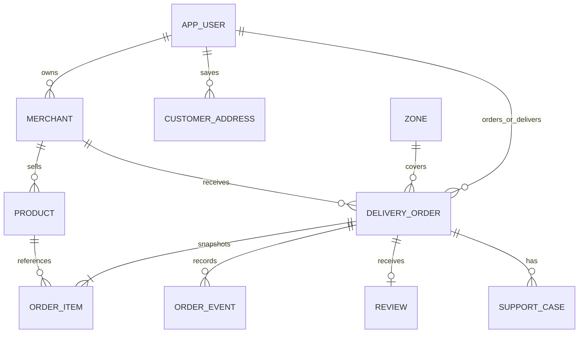

# Arquitectura y contrato HTTP inicial

## Modelo relacional implementado



`delivery_order` mantiene estados de operación y de pago separados, snapshots de importes, versión de concurrencia y clave idempotente por cliente. En esta primera versión pedido y entrega comparten tabla; no hay entidad de oferta automática. `order_item` guarda nombre y precio al confirmar, además de la referencia al producto. Los productos se ocultan; no se borran sus referencias históricas.

## Seguridad

Todas las mutaciones requieren CSRF. Obtener `GET /api/auth/csrf`, conservar cookie de sesión y enviar el token en la cabecera indicada en la respuesta. Tras login/logout, obtener un token nuevo. Login usa `application/x-www-form-urlencoded`; el resto de mutaciones usa JSON. El rol público de registro siempre es CUSTOMER. La UI no determina la autorización.

Respuestas de error: 400 datos inválidos; 401 sin sesión; 403 acceso denegado; 404 recurso inexistente; 409 conflicto de negocio/versión/duplicidad. No se devuelven trazas de SQL al cliente.

## Rutas

| Método | Ruta | Uso / acceso |
|---|---|---|
| GET | `/api/auth/csrf` | Token CSRF, público |
| GET | `/api/auth/me` | Identidad actual o null |
| POST | `/api/auth/register` | Registro de cliente |
| POST | `/api/auth/login` | Sesión con username/password |
| POST | `/api/auth/logout` | Cierre de sesión |
| GET | `/api/catalog/merchants` | Catálogo público |
| GET | `/api/catalog/products?merchantId=selva` | Productos activos |
| GET | `/api/catalog/zones` | Zonas activas y radios |
| GET | `/api/catalog/settings` | Adicional vigente por lluvia |
| GET | `/api/orders` | Pedidos del actor; administración ve todos, límite 100 |
| POST | `/api/orders` | Checkout de cliente |
| GET | `/api/orders/{id}` | Detalle, items, eventos, reseña; solo participantes/admin |
| POST | `/api/orders/{id}/actions` | Acción autorizada con versión y motivo |
| POST | `/api/orders/{id}/review` | Calificar pedido entregado, una sola vez |
| POST | `/api/orders/{id}/support` | Abrir caso por participante |
| GET | `/api/merchant/catalog` | Catálogo propio, incluidos ocultos |
| POST/PUT/DELETE | `/api/merchant/products[/{id}]` | Crear, editar, ocultar |
| PUT | `/api/merchant/{id}/open` | Abrir/cerrar comercio propio |
| GET | `/api/courier/available` | Resumen de pedidos listos, sin dirección privada |
| PUT | `/api/courier/availability` | Disponibilidad del repartidor |
| GET | `/api/courier/earnings` | Ganancia, liquidación pendiente, efectivo por rendir |
| GET | `/api/admin/summary` | Totales, usuarios, casos y ventas por comercio |
| PUT | `/api/admin/rain` | Cambiar adicional para nuevos pedidos |
| PUT | `/api/admin/users/{id}` | Suspender/reactivar, excepto administrador |
| PUT | `/api/admin/cases/{id}` | Resolver un caso abierto |
| GET/POST/DELETE | `/api/addresses[/{id}]` | Hasta tres direcciones del cliente |
| GET | `/api/support` | Casos creados por el actor |

### Checkout de ejemplo

```json
{
  "merchantId": "selva",
  "zoneId": "tarapoto",
  "address": "Dirección ficticia 123",
  "latitude": -6.4889,
  "longitude": -76.3597,
  "paymentMethod": "CASH",
  "tip": 2.00,
  "expectedTotal": 25.00,
  "idempotencyKey": "una-clave-unica-por-checkout",
  "items": [{"productId":"juane","quantity":1}]
}
```

`expectedTotal` es la cantidad que el cliente revisó; no impone el precio al servidor. El servidor recalcula todo y rechaza si no coincide. La misma clave y contenido devuelve el pedido previo; misma clave con contenido distinto devuelve 409. Se ordenan locks de productos por ID y se serializa la confirmación por cliente. El lock del comercio también evita confirmar mientras se cierra; es conservador y limita throughput por comercio, aceptable para esta demo.

### Transiciones

```text
PENDING -> PREPARING -> READY -> ASSIGNED -> TO_STORE -> AT_STORE
        -> PICKED_UP -> ON_THE_WAY -> ARRIVED -> DELIVERED
```

Comercio marca PREPARE/READY; repartidor usa CLAIM y después la secuencia logística. Cliente cancela solo en PENDING; comercio/admin en PENDING o PREPARING. Los estados terminales no se reabren. Ejemplo de acción: `{"action":"PREPARE","version":0,"reason":""}`.

Yape: UNPAID -> VERIFYING -> PAID. Una referencia no equivale a verificación. Rechazo regresa a UNPAID. Cancelación pagada: REFUND_PENDING -> REFUNDED; sin cobro: VOID. Efectivo se marca PAID al entregar con confirmación explícita de cobro. Administración registra rendición y liquidación con motivos/constancias. Todos estos registros son simulados, no una API financiera.

## Límites de diseño pendientes

Los permisos son roles fijos y propiedad por comercio, no RBAC configurable. El historial de pedidos es persistente pero no hay un ledger financiero completo ni registro general de cambios de configuración. No hay paginación por cursor, búsqueda de productos global, migraciones versionadas o notificaciones push. La cobertura usa radios geográficos de zonas, no rutas transitables ni radios individuales por comercio. Estas limitaciones se deben cerrar según el backlog, no ocultarse en la sustentación.
